# VoyageAI — Current Dependency Map

Actual dependencies as they exist today (not the desired future state).

## Diagram

```mermaid
graph TD
  subgraph Entry
    main["src/main.tsx"]
    EB["ErrorBoundary.tsx"]
    BR["BrowserRouter (react-router-dom)"]
    AR["AppRoutes.tsx (route table + URL→store sync)"]
    R["routes.ts (VIEW_PATH / pathToView / viewToPath)"]
  end

  subgraph UI["UI Components (src/components)"]
    App["App.tsx (orchestration)"]
    Navbar[Navbar] & Hero[Hero] & PlaceExplorer[PlaceExplorer] & PlaceImage[PlaceImage]
    Itin[ItineraryView] & BM[BookmarksView] & Rev[ReviewModal] & Toast[NotificationToast]
    AuthModal[AuthModal] & Planner[AiPlannerModal] & Chat[AiChatDrawer]
    PDM[PlaceDetailsModal] & Profile[ProfileView] & Admin[AdminDashboard]
  end

  subgraph Stores["UI Stores (src/stores)"]
    UI["uiStore.ts (useUiStore)"]
  end

  subgraph Services["Services (src/services)"]
    AI["aiTravelAgent.ts (aiAgent)"]
    Auth["authService.ts (authService)"]
    FS["firestoreService.ts (firestoreService)"]
    DC["dataConnectService.ts (dataConnect)"]
    Geo["geolocation.ts"]
    PI["placeImages.ts"]
    FB["firebase.ts (init: app/auth/firestore/ai/app-check)"]
  end

  subgraph Types["Domain types (src/types/travel.ts)"]
    T[travel.ts]
  end

  subgraph Utils["Shared helpers (src/utils)"]
    U["validation.ts (JSON type guards)"]
  end

  subgraph Trip["Trip workspace (structured planning + verification foundation: STEP 13–20; persisted since STEP 09)"]
    TripTypes["types/trip.ts"]
    TripModel["domain/trips/tripModel.ts"]
    TripView["components/trips/TripWorkspace.tsx"]
    TripSer["services/tripSerialization.ts"]
    TripSerModel["services/tripSerializationModel.ts"]
    TripSvc["services/tripService.ts"]
    TripPage["components/trips/TripWorkspacePage.tsx"]
    TripPlan["domain/trips/tripPlanning.ts"]
    TripPlanEdit["domain/trips/tripPlanningEdit.ts"]
    ExecReadiness["domain/trips/executionReadiness.ts (STEP 17, refined STEP 19)"]
    ExecChecklist["domain/trips/executionChecklist.ts (STEP 18)"]
    VerifState["domain/trips/verificationState.ts (STEP 19 — unconsumed)"]
    ProvCap["domain/providers/providerCapabilities.ts (STEP 20 — unconsumed)"]
    ProvAdapter["domain/providers/providerAdapter.ts (STEP 20 — unconsumed)"]
    ProvResults["domain/providers/providerResults.ts (STEP 20 — unconsumed)"]
    ProvVerifProducer["domain/providers/verificationProducer.ts (STEP 20 — unconsumed)"]
    BookingLifecycle["domain/providers/bookingLifecycle.ts (STEP 20 — unconsumed)"]
    ProvExecOps["domain/providers/executionOperations.ts (STEP 20 — unconsumed)"]
    ProvApproval["domain/providers/executionApprovalAudit.ts (STEP 20 — unconsumed)"]
    DiscoveryInput["domain/providers/discoveryInput.ts (STEP 21 — consumed by mockDiscovery)"]
    MockFixtures["services/mockDiscovery/mockFixtures.ts (STEP 21 — deterministic fixtures)"]
    MockTransport["services/mockDiscovery/mockTransportProvider.ts (STEP 21 mock adapter)"]
    MockAccommodation["services/mockDiscovery/mockAccommodationProvider.ts (STEP 21 mock adapter)"]
    MockProviders["services/mockDiscovery/mockProviders.ts (STEP 21 adapter registry)"]
    MockDiscoverySvc["services/mockDiscovery/mockDiscoveryService.ts (STEP 21 read-only entry point)"]
    DiscPanel["components/trips/DiscoveryPanel.tsx (STEP 21 presentational)"]
    Handoff["domain/discovery/handoff.ts (STEP 22 — user-controlled import)"]
    Provenance["domain/trips/planningProvenance.ts (STEP 23 — reference provenance vocabulary)"]
    Lifecycle["domain/trips/planningLifecycle.ts (STEP 24 — reference lifecycle vocabulary)"]
    ProjRef["domain/trips/planningReferenceProjection.ts (STEP 25 — read-only lifecycle projection)"]
    SelRef["domain/trips/planningReferenceSelection.ts (STEP 26 — user-controlled primary selection)"]
    Confl["domain/trips/planningReferenceConflict.ts (STEP 27 — primary-assignment conflict wording)"]
    Resol["domain/trips/planningReferenceResolution.ts (STEP 28 — explicit conflict-resolution vocabulary)"]
    ChangeCtx["domain/trips/planningReferenceChangeContext.ts (STEP 29 — planning-reference change history context)"]
    TripProposal["domain/trips/tripPlanningProposal.ts"]
    AiPlanSvc["services/aiPlanningService.ts (STEP 15 — no Firestore)"]
    PlanEditor["components/trips/PlanningEditor.tsx"]
    MyTripsList["components/trips/MyTripsPage.tsx"]
    MyTripsView["components/trips/MyTripsView.tsx"]
  end

  main --> EB
  main --> BR
  EB --> BR
  BR --> AR
  AR --> R
  AR --> App
  AR --> UI

  App --> Navbar
  App --> Hero
  App --> PlaceExplorer
  App --> Itin
  App --> BM
  App --> Rev
  App --> Toast
  App --> PDM
  App --> Planner
  App --> Chat
  App --> AuthModal
  App --> Profile
  App --> Admin
  PlaceExplorer --> PlaceImage

  %% Components/router-store
  Navbar --> R
  App --> R

  %% Components/stores
  App --> UI

  %% Smart components calling services directly
  AuthModal --> Auth
  Planner --> AI
  Planner --> Geo
  Chat --> AI
  Chat --> Geo
  PDM --> DC
  Profile --> Auth
  Profile --> DC
  Admin --> FS
  Admin --> Auth
  TripPage --> Auth
  TripPage --> R
  TripPage --> TripModel

  %% App -> services
  App --> AI
  App --> DC
  App --> Auth
  App --> Geo
  App --> PI

  %% service -> service
  AI --> DC
  AI --> PI
  AI --> Geo
  AI --> FB
  Auth --> DC
  Auth --> FS
  Auth --> FB
  DC --> FS

  %% Services -> shared validation helpers
  AI --> U
  Geo --> U
  PI --> U

  %% services -> firebase
  FS --> FB
  TripSvc --> FB

  %% trip persistence chain
  TripSvc --> TripSer
  TripSvc --> TripTypes
  TripSer --> TripTypes
  TripSer --> TripSerModel
  TripSerModel --> TripTypes
  TripPage --> TripSvc
  TripPage --> TripView
  TripPage --> TripTypes
  TripPage --> TripPlanEdit
  TripPage --> TripProposal
  TripPage --> AiPlanSvc
  TripPage --> PlanEditor
PlanEditor --> TripPlanEdit
   PlanEditor --> TripProposal
   TripPlanEdit --> TripPlan
   TripPlanEdit --> TripTypes
   TripPlan --> TripTypes
TripPlan --> ExecReadiness
    PlanEditor --> ExecReadiness
    ExecReadiness --> TripTypes
    TripPlanEdit --> ExecChecklist
    PlanEditor --> ExecChecklist
    ExecChecklist --> TripTypes
    VerifState --> TripTypes
    VerifState --> TripPlan
    ProvAdapter --> ProvCap
    ProvResults --> TripTypes
    ProvResults --> TripPlan
    ProvVerifProducer --> TripTypes
    ProvVerifProducer --> VerifState
    ProvVerifProducer --> TripPlan
    ProvVerifProducer --> ProvExecOps
    BookingLifecycle --> TripTypes
    ProvApproval --> ProvExecOps
    MockFixtures --> ProvResults
    MockFixtures --> DiscoveryInput
    MockTransport --> MockFixtures
    MockTransport --> ProvAdapter
    MockTransport --> ProvExecOps
    MockTransport --> ProvResults
    MockTransport --> DiscoveryInput
    MockTransport --> ProvCapabilities
    MockAccommodation --> MockFixtures
    MockAccommodation --> ProvAdapter
    MockAccommodation --> ProvExecOps
    MockAccommodation --> ProvResults
    MockAccommodation --> DiscoveryInput
    MockAccommodation --> ProvCapabilities
    MockProviders --> MockTransport
    MockProviders --> MockAccommodation
    MockProviders --> ProvAdapter
    MockProviders --> ProvCapabilities
    MockProviders --> ProvExecOps
    MockProviders --> ProvResults
    MockDiscoverySvc --> DiscoveryInput
    MockDiscoverySvc --> ProvAdapter
    MockDiscoverySvc --> ProvExecOps
    MockDiscoverySvc --> ProvResults
    MockDiscoverySvc --> MockProviders
    TripPage --> MockDiscoverySvc
    TripPage --> DiscPanel
    DiscPanel --> MockDiscoverySvc
    DiscPanel --> MockFixtures
    DiscPanel --> ProvResults
    DiscPanel --> ProvExecOps
    DiscPanel --> DiscoveryInput
    Handoff --> TripPlan
    Handoff --> TripTypes
    TripPage --> Handoff
    TripPlan --> Provenance
    PlanEditor --> Provenance
    TripPlan --> Lifecycle
    PlanEditor --> Lifecycle
    TripView --> ProjRef
    TripView --> Provenance
    ProjRef --> Lifecycle
    ProjRef --> TripTypes
    PlanEditor --> SelRef
    TripView --> SelRef
    SelRef --> ProjRef
    SelRef --> Lifecycle
    SelRef --> TripTypes
    Confl --> ProjRef
    Confl --> Lifecycle
    Confl --> SelRef
    Confl --> TripTypes
    Resol --> Confl
    Resol --> SelRef
    PlanEditor --> Confl
    PlanEditor --> Resol
    ChangeCtx --> Lifecycle
    ChangeCtx --> Provenance
    ChangeCtx --> Confl
    ChangeCtx --> TripTypes
    PlanEditor --> ChangeCtx
    TripView --> Confl
  TripProposal --> TripPlanEdit
  TripProposal --> TripPlan
  TripProposal --> TripTypes
  AiPlanSvc --> TripProposal
  AiPlanSvc --> TripPlanEdit
  AiPlanSvc --> TripPlan
  AiPlanSvc --> TripTypes
  AiPlanSvc --> FB
  TripSvc --> TripPlanEdit
  AR --> TripPage
  AR --> MyTripsList
  MyTripsList --> Auth
  MyTripsList --> R
  MyTripsList --> TripSvc
  MyTripsList --> MyTripsView
  MyTripsView --> TripModel
  MyTripsView --> TripTypes

  %% App -> trip promotion
  App --> TripModel
  App --> TripSvc
  Geo --> T
  PI --> T
  FB -.-> FBApp["Firebase App / Auth / Firestore / AI (App Check)"]
  AI -.-> Gemini["Gemini (firebase/ai)"]
  AiPlanSvc -.-> Gemini
  Geo -.-> Nominatim["Nominatim API"]
  PI -.-> Wiki["Wikipedia / Wikimedia Commons"]
  Auth -.-> FBAuth["Firebase Auth"]

  %% types shared broadly
  App -.-> T
  AI -.-> T
  Auth -.-> T
  FS -.-> T
  DC -.-> T
  Navbar -.-> T
  Hero -.-> T
  PlaceExplorer -.-> T

  %% trip domain (persisted + routed; the page sits under AppRoutes, not App)
  TripModel --> TripTypes
  TripModel -. "type-only (Itinerary)" .-> T
  TripView --> TripTypes
```

## Important coupling points

1. **`App.tsx` is the hub.** It depends on all five services (AI, data, auth, geolocation,
   images) plus every functional component. Any change to a service contract or view flow
   ripples through `App`.
2. **Routing is centralized in the composition layer.** `main.tsx` → `BrowserRouter` →
   `AppRoutes` owns the route table and the one-way URL→store sync (`SyncActiveView`).
   `routes.ts` is a pure typed mapping imported by `AppRoutes`, `App`, and `Navbar` (no
   React import). `Navbar` no longer reads the store; it navigates and derives the active
   tab from the URL, so the URL is the single source of truth. View routes define paths
   from `uiStore`'s `ActiveView` union (only a type flows across that boundary); the trip
   area is two extra non-view routes rendered without mounting `App`: the `/trips` owner
   list (`MyTripsPage`) and the workspace page (`/trips/:tripId` → `TripWorkspacePage`).
3. **Smart components bypass `App`.** AuthModal, AiPlannerModal, AiChatDrawer,
   PlaceDetailsModal, ProfileView, and AdminDashboard call services directly, so service
   call sites are not centralized.
4. **The data service is the middle of a triangle.** `aiTravelAgent` and `authService`
   both depend on `dataConnectService`, which depends on `firestoreService`. The local
   (localStorage) layer is the app's primary store and Firestore is a fire-and-forget
   mirror.
5. **`firebase.ts` is the only module that imports `firebase/*` beside the services.**
   No UI component touches the Firebase SDK directly.
6. **`AdminDashboard` is the only component that uses `firestoreService` directly** (admin
   reads) and it hardcodes the admin identity check.
7. **Providers are reached through raw `fetch` in two services** — `geolocation.ts`
   (Nominatim) and `placeImages.ts` (Wikipedia/Commons) — which keeps them mockable via
   `vi.stubGlobal('fetch')`.
8. **`uiStore.ts` is the only Zustand store** — it holds UI-only state (`activeView`) and
   depends only on `zustand`. It is a compatibility layer mirrored from the URL by
   `AppRoutes`; `App` renders from it, no service imports the store and the store imports
   no service/React module (no circular dependency).
9. **Trip workspace is wired in as an independent, narrow path.** `tripModel` depends on
   `types/trip` and type-only on `types/travel`; `TripWorkspace.tsx` depends only on
   `types/trip` (presentational). `tripSerialization` maps docs purely, delegating
   itinerary validation to the equally pure `tripSerializationModel` (both SDK-free).
   `tripService` is the only new `firebase/firestore` caller for trips and is
   independently mockable (unit tests never load the SDK). `TripWorkspacePage` (under
   `AppRoutes`, not `App`) composes auth + service + view, keeping the `App` orchestration
   hub out of the loop for trips. Its on-page editing boundary (title + itinerary overview)
   is the only write path that mutates a loaded workspace beyond creation. STEP 11 added
   the owner-scoped list: `MyTripsPage` (under `AppRoutes`, outside `App`) subscribes to
   `authService` and calls `tripService.listTripsForOwner`, rendering the presentational
   `MyTripsView` (which reaches `tripModel` only for duration math). The list query is
   `where('ownerId','==',uid)` with malformed docs skipped and client-side `updatedAt`
   ordering (no composite index). STEP 12 adds `tripModel → types/trip` lifecycle policy
   (status transitions, title normalization, delete eligibility) consumed by both
   `TripWorkspacePage` (UI constraints) and `tripService` (service-layer enforcement).
   No
   circular dependency exists anywhere; services/Firebase still never import the router.
   STEP 13 adds the read-only structured planning projection: `tripPlanning` (pure domain,
   `src/domain/trips/tripPlanning.ts`) projects a loaded workspace into `TripPlanningData`
   (dates, destinations, days, transportation, accommodation, budget, notes, references);
   `types/trip` extends `TripItinerarySnapshot` with optional `notes`/`references`
   (`TripPlanningReference` = identifier-only activity/transport/accommodation references);
   `tripSerializationModel`/`tripSerialization` accept and validate those keys at the
   persistence boundary; `TripWorkspace` renders the budget summary, planning notes, and
   external references as a read-only structured block. No new collection, index, or rules
   change; nothing is re-persisted and the projection is rebuilt per read.
   STEP 14 makes the first five structured planning sections editable with bounded,
   explicit-save persistence: `tripPlanningEdit` (pure domain, `src/domain/trips/
tripPlanningEdit.ts`) owns normalization/application/dirty/problem-checking of a
   `TripPlanningUpdate` (trip dates, destinations, days, notes, references) and shares the
   projection guards (`isTripDateRange`, `isTripDestinationRecord`, `isActivityRecord`,
   and `isSafeHttpUrl` — all now exported from `tripPlanning`); `tripService` adds the
   narrow `updateTripPlanning` write path that re-uses the whitelisted `updateTrip`
   internal (ownership + `updatedAt` + error mapping preserved); `PlanningEditor` (presentational,
   under `TripWorkspacePage`) renders the editable sections and the explicit **Save
   planning** flow. **Dependency direction is one-way and unchanged:** UI → domain → types
   and UI/services → domain; nothing new crosses into Firebase/React from the domain, and
   the page composes the editor without the editor knowing the service. Connections added
   to the diagram: `TripSvc → tripPlanningEdit`, `TripPage → tripPlanningEdit`,
   `TripPage → PlanningEditor`, `PlanningEditor → tripPlanningEdit`,
   `tripPlanningEdit → tripPlanning/types/trip`, `tripPlanning → types/trip`.
   STEP 15 adds the AI planning-assist layer on top of that edit boundary:
   `tripPlanningProposal` (pure, SDK-free) owns the bounded AI request/proposal model and
   reuses the **shared** `tripPlanningEdit` update normalization for the proposed `update`,
   so AI output is validated by exactly the same strict boundary as manual edits — but the
   proposal scope is locked to the five AI-owned sections via
   `ALLOWED_PROPOSAL_UPDATE_KEYS`, so the STEP 16 user-editable transport/accommodation/
   budget (and any lifecycle/metadata) edits are rejected at the same place;
   `aiPlanningService` (in `services/`) depends only on `firebase/ai` + `./firebase`
   (`getAIService`) for Gemini generation and on the pure proposal/request normalization —
   it deliberately has **no `firebase/firestore` import and no reference to `tripService`**,
   so the AI cannot write by construction. `TripWorkspacePage` composes the generation call
   and owns the proposal state; `PlanningEditor` renders instruction entry, generation
   loading, the proposal preview (via `summarizeProposalChanges`), and Apply/Discard, and
   the page only persists through the existing explicit `updateTripPlanning` save. New
   edges: `TripProposal → tripPlanningEdit/tripPlanning/types/trip`,
   `AiPlanSvc → TripProposal/tripPlanningEdit/tripPlanning/types/trip/firebase`,
   `TripPage → TripProposal/AiPlanSvc`, `PlanningEditor → TripProposal`. Direction stays
   one-way (UI → service → domain → types); no component, domain, or AI service imports
   Firebase Firestore, and the `aiPlanningService` node is labeled as the no-Firestore AI
   boundary to keep it unmistakable.
   STEP 16 makes the transport plans, accommodation plans, and budget plan editable:
   `tripPlanning` adds the plan guards/normalizers (`isTripTransportPlan`/
   `normalizeTripTransportPlan`, `isTripAccommodationPlan`/`normalizeTripAccommodationPlan`,
   `isTripBudgetPlan`/`normalizeTripBudgetPlan` with unknown allocation keys dropped);
   `tripPlanningEdit` extends the update model to eight sections (`ALLOWED_UPDATE_KEYS`)
   with per-section helpers (`updateTripTransportPlans`, `updateTripAccommodationPlans`,
   `updateTripBudgetPlan`) and `collapseEmptyBudgetPlan`; the sections are persisted as
   optional `TripItinerarySnapshot` fields through the existing `tripService.updateTripPlanning`
   write path (validated at `tripSerializationModel` for unique ids; `budgetPlan: null`
   clears); `PlanningEditor` gains explicit Edit/Cancel editors for the three sections.
   The AI proposal scope stays locked to the five AI-owned sections — the STEP 16 sections
   remain user-editable-only. No new collections, migrations, indexes, or rules; dependency
   direction remains one-way UI → service → domain → types.
   STEP 17 adds the **execution-readiness foundation**: an optional, user-settable
   `readiness` label on each transport/accommodation plan (`TripExecutionReadiness` =
   `{ state, note? }` with states `planned | user-confirmed | externally-verified |
 cancelled | unknown`, where "booked/provider-confirmed" maps to `externally-verified` and
   is **not** user-producible — `canUserSetReadinessState` gates it). The new pure, SDK-free
   domain module `executionReadiness` owns the vocabulary, type guards, the normalizer
   (malformed → `null`), the label function, and draft-only future execution-record
   contracts (`TripExecutionRecord` union) that no module imports yet. `tripPlanning`'s plan
   normalizers accept the optional readiness; `tripPlanningEdit` deep-clones it through the
   update/apply path and `cloneSnapshot`; `PlanningEditor` renders a read-only chip for each
   plan. Persistence rides the existing snapshot (`transportPlans`/`accommodationPlans` carry
   `readiness` through `tripService.updateTripPlanning`); `tripSerializationModel`'s
   snapshot normalizer accepts it and rejects booking-claim / malformed states. New edges:
   `TripPlan → ExecReadiness`, `PlanEditor → ExecReadiness`, `ExecReadiness → TripTypes`.
   No new collections, migrations, indexes, or rules; no booking/external-verification API;
   dependency direction stays one-way UI → service → domain → types.
   STEP 18 adds the **execution-preparation checklist**: a new pure, SDK-free domain module
   `executionChecklist` owns the task vocabulary/guards/`normalizeTripChecklistItem`/
   `hasUniqueTaskIds`/neutral labels; `types/trip` gains `TripTaskStatus` /
   `TripTaskCategory` / `TripTaskRelatedSection` / `TripChecklistItem` plus an optional
   `tasks` key on `TripItinerarySnapshot` and on `TripPlanningUpdate` (`null` clears);
   `tripPlanningEdit` adds `tasks` to `ALLOWED_UPDATE_KEYS` (ninth section), the
   `updateTripTasks` helper, and `collapseTripTasks` (empty/`null` collapses to absent for
   dirty-checking); `tripSerializationModel` validates tasks per-item at the snapshot
   boundary; the checklist persists through the existing `tripService.updateTripPlanning`
   write path; `PlanningEditor` renders the explicit checklist editor. Tasks are
   **user-authored only** — `ALLOWED_PROPOSAL_UPDATE_KEYS` in `tripPlanningProposal` stays
   locked to the five AI-owned sections, so no proposal can create/edit/complete/skip a
   task. New edges: `TripPlanEdit → ExecChecklist`, `PlanEditor → ExecChecklist`,
   `ExecChecklist → TripTypes`. No new collections, migrations, indexes, or rules;
   dependency direction stays one-way UI → service → domain → types.
   STEP 19 adds the **external-verification foundation** — domain-only and unconsumed: the new pure,
   SDK-free module `verificationState` owns the seven-state verification vocabulary
   (`TripVerificationState`), the `TripVerificationEvidence` evidence model, the transition
   gates, and the producer boundary (producer-owned states are never user-producible). It
   imports only `types/trip` plus `isSafeHttpUrl` from `tripPlanning` — it is **not imported
   by any module**, so nothing persists, sends to the AI, or renders it as a control.
   `executionReadiness`'s DRAFT-ONLY `TripExecutionRecord` contracts were refined to use the
   richer `TripVerificationState` / `TripVerificationEvidence` / `TripBookingCategory` shape
   (types-only import, unchanged dependency position). New edges:
   `VerifState → TripTypes`, `VerifState → TripPlan`. No module imports `VerifState`. No new
   collections, migrations, indexes, or rules; dependency direction stays one-way
   UI → service → domain → types.
   STEP 21 adds **read-only external discovery** that consumes the STEP 20 provider architecture
   inside the app: the pure `discoveryInput` query boundary (the eighth `src/domain/providers/`
   module: 2 categories, bounded destination/origin/dates/traveler-count/currency, strict
   unknown-key rejection) plus a deterministic `src/services/mockDiscovery/` set — `mockFixtures`
   (fixture data incl. `Mock Express Rail` and hotel fixtures, `MOCK_RESULT_DISCLAIMER`,
   freshness sentinel, `MOCK_EMPTY_RESULTS_DESTINATION`/`MOCK_PROVIDER_FAILURE_DESTINATION`,
   `MOCK_SOURCE_URL_PREFIX`), `mockTransportProvider` / `mockAccommodationProvider` (mock
   adapters whose only executed capability is the read-only `search-*`; booking/verify/retrieve
   capabilities are `unsupported` or `temporarily-unavailable`), `mockProviders` (registry +
   category→capability map), and `mockDiscoveryService` (single read-only entry point
   `discoverTripOptions(raw, now)`; outcome statuses `success`/`empty`/`unsupported`/
   `provider-failure`/`invalid-input`/`unexpected-failure`). The presentational `DiscoveryPanel`
   is mounted by `TripWorkspacePage`. New edges:
   `DiscoveryInput` (dependency-free: no imports; the pure query boundary imported by `MockFixtures`,
   both adapters, `MockProviders`, `MockDiscoverySvc`, `DiscPanel`, and `TripWorkspacePage`),
   `MockFixtures → DiscoveryInput/ProvResults`,
   `MockTransport → MockFixtures/ProvAdapter/ProvCapabilities/ProvExecOps/ProvResults/DiscoveryInput`,
   `MockAccommodation → MockFixtures/ProvAdapter/ProvCapabilities/ProvExecOps/ProvResults/DiscoveryInput`,
   `MockProviders → MockTransport/MockAccommodation`,
   `MockDiscoverySvc → DiscoveryInput/ProvAdapter/ProvExecOps/ProvResults/MockProviders`,
   `DiscPanel → MockDiscoverySvc/DiscoveryInput/ProvResults/ProvExecOps/MockFixtures`,
   `TripWorkspacePage → MockDiscoverySvc/DiscPanel/DiscoveryInput`.
   The mock service layer is **strictly read-only**: it never imports `tripService`,
   `firestoreService`, or `dataConnectService`, never persists, never books/pays/verifies/cancels,
   performs no network calls and holds no credentials, and the AI proposal scope
   (`ALLOWED_PROPOSAL_UPDATE_KEYS`) stays locked to the five AI-owned sections (STEP 21 boundary
   tests reject every discovery key in a proposal update). No new collections, migrations,
   indexes, or rules; dependency direction stays one-way UI → service → domain → types.
   STEP 23 adds **typed planning-reference provenance** for the explicitly-entered transport and
   accommodation plans. A new pure, SDK-free module `src/domain/trips/planningProvenance.ts` owns
   the only provenance vocabulary: four kinds (`manual`, `ai-generated`, `mock-discovery`,
   `external-provider`) plus `MAX_PLAN_PROVENANCE_NOTE_LENGTH = 500`, the strict
   `normalizeTripPlanProvenance` gate (unknown kinds and over-long/non-string notes reject the
   whole record; notes are trimmed and dropped when empty; runtime-only keys never persist),
   `isTripPlanProvenanceKind`/`isTripPlanProvenance`, the honest read-only
   `getTripPlanProvenanceLabel`/`getTripPlanProvenanceDescription` helpers, and the
   `isSimulatedProvenance`/`isExternalProviderProvenance` predicates. `types/trip` gains an
   optional `provenance` field on transport/accommodation plans (absent on legacy records stays
   absent — never inferred); `tripPlanning` validates it through the shared gate; `tripPlanningEdit`
   deep-copies it (`clonePlanWithMetadata`), so applying/dirty-checking a provenance change never
   aliases the snapshot; the STEP 22 handoff stamps `mock-discovery` provenance with a fixed honest
   note on every imported plan (`DISCOVERY_HANDOFF_PROVENANCE_NOTE`, equal to the readiness note);
   `tripSerializationModel` round-trips it; and `PlanningEditor` renders a read-only provenance
   chip ("Manual reference" / "AI-generated reference" / "Simulated discovery" / "External provider
   reference — not verified"), a bounded "Source note" input shown **only** when provenance exists
   (legacy plans are untouched by viewing or focusing), an explicit **Mark as manually entered**
   action available only on simulated-discovery plans (the sole kind-changing gesture; ordinary
   field edits never retype a kind), and the honest `manual` default for newly added plans. No
   claim is made about live availability, verification, booking, payment, cancellation, provider
   integration, freshness, or auto-execution. New edges:
   `TripPlan → Provenance`, `PlanEditor → Provenance`; the handoff stamps its provenance by
   construction (no import), keeping `domain/discovery` at exactly one module.
   No new collections, migrations, indexes, or rules.
   STEP 24 adds **user-controlled planning-reference lifecycle** for the same explicitly-entered
   plans. A new pure, SDK-free module `src/domain/trips/planningLifecycle.ts` owns the only
   lifecycle vocabulary: the four states `active` / `needs-review` / `replaced` / `archived`,
   `TRIP_PLAN_LIFECYCLE_STATES`, `DEFAULT_TRIP_PLAN_LIFECYCLE_STATE = 'active'`,
   `isTripPlanLifecycleState` / `normalizeTripPlanLifecycleState` (unknown values reject the
   whole record — never guessed), `getEffectiveTripPlanLifecycleState` (legacy records read as
   `active`, computed but never written back), the honest read-only
   `getTripPlanLifecycleLabel` / `getTripPlanLifecycleDescription` helpers (wording never
   claims expiry, staleness, price changes, verification, or a booking), and the
   `isActiveReference` / `requiresPlanReview` / `isArchivedReference` predicates. `types/trip`
   gains an optional `lifecycleState` on transport/accommodation plans; `tripPlanning` gates
   it in the shared plan normalizers; `tripPlanningEdit` carries the scalar through the deep
   clone (`clonePlanWithMetadata` spreads scalars), so lifecycle-aware drafts never alias the
   snapshot; the STEP 22 handoff stamps `lifecycleState: 'active'` by construction
   (`DISCOVERY_HANDOFF_LIFECYCLE_STATE`); `tripSerializationModel` round-trips it; and
   `PlanningEditor` renders a read-only lifecycle chip on each plan card (labels "Active" /
   "Needs review" / "Replaced" / "Archived" via the effective state, so legacy plans read as
   Active without being changed) plus lifecycle actions (Mark for review / Mark as active /
   Mark as replaced / Archive / Restore — rendered only while the section is being edited,
   disabled while `inputsDisabled`). Lifecycle is strictly user-controlled: no staleness
   detection, no date math, no timers, no clock, no external freshness source, and no
   automatic transitions. Replace/archive are decisions, not deletions — no replacement record
   is invented and nothing is deleted (data, provenance, sourceUrl, and readiness stay intact).
   Lifecycle never implies availability, pricing, verification, a booking, or a provider claim,
   and is fully separate from provenance (origin) and readiness (progress). New edges:
   `TripPlan → Lifecycle`, `PlanEditor → Lifecycle`; the handoff stamps its lifecycle by
   construction (no import). The AI proposal scope is unchanged, and there are no new
   collections, migrations, indexes, or rules.
   STEP 25 adds a **read-only, lifecycle-consistent plan projection** for non-editing surfaces,
   so the distinction between active and inactive planning references is consistent everywhere
   plans are rendered. A new pure, SDK-free module `src/domain/trips/planningReferenceProjection.ts`
   owns the only read-time grouping vocabulary: `isLegacyPlanningReference`,
   `getEffectivePlanningReferenceState` (delegates to the lifecycle `active` default),
   `isPrimaryPlanningReference` (active/needs-review, legacy included),
   `isSecondaryPlanningReference` (replaced/archived), `isReplacedPlanningReference`,
   `isArchivedPlanningReference`, `partitionPlanningReferences` (order-preserving, non-mutating
   split into primary/secondary), `countPlanningReferences`, `getPlanningReferenceSummary`, and
   the honest read-only `getPlanningReferenceDisplayLabel` ("Legacy reference — treated as
   active" / "Active" / "Needs review" / "Replaced reference" / "Archived reference"). The
   read-only `TripWorkspaceView` (previously `types/trip`-only) now renders the transport and
   accommodation plan references inside the "Structured planning" card: a primary list with a
   lifecycle chip (needs-review visibly marked) and a separate provenance chip (via
   `planningProvenance`), plus an always-visible "Replaced / archived (n)" subgroup in original
   order — no editing controls anywhere. The projection imports only `types/trip` and
   `planningLifecycle`, reads only, never persists, and never infers lifecycle from
   provenance/readiness/dates/texts/URLs. `PlanningEditor` remains the only lifecycle-editing
   surface. New edges: `TripView → ProjRef`, `TripView → Provenance`, `ProjRef → Lifecycle`,
   `ProjRef → TripTypes`. The AI proposal scope is unchanged, and there are no new collections,
   migrations, indexes, or rules.
   STEP 26 adds a **user-controlled primary reference selection** that stays strictly explicit.
   A new pure, SDK-free module `src/domain/trips/planningReferenceSelection.ts` owns the only
   read-time interpretation of the section-level `primaryTransportPlanId` /
   `primaryAccommodationPlanId` fields that now live on the itinerary snapshot (optional, absent
   by default). Absence means no selection; nothing auto-promotes the first plan and a missing or
   inactive selection is preserved as stored (surfaced as a non-blocking "needs attention" state
   with an honest reason). The vocabulary: `isPrimaryPlanId` / `normalizePrimaryPlanId` (trim,
   reject non-string/empty), `isPlanEligibleAsPrimary` (effective-active only, legacy read-time
   default included), `resolvePrimarySelection` (exactly `no-explicit-selection |
 valid-explicit-selection | selected-plan-missing | selected-plan-inactive`),
   `partitionPlanningReferencesWithPrimary` (selected + eligibleActive + needsReview + secondary,
   order-preserving and non-mutating), `isPrimarySelectionAttentionState`, and
   `getPrimarySelectionStatusLabel`. `types/trip` gains the two optional primary id fields on
   `TripPlanningUpdate` / `TripItinerarySnapshot` / `TripPlanningData`; `tripPlanning` trims them
   at normalization, `tripPlanningEdit` applies/clears them only when an itinerary exists
   (`null` = explicit clear), and `tripSerializationModel` round-trips a present trimmed id.
   `PlanningEditor` gains a per-section Primary control (status chip + select offering eligible
   active plans only; staged into the local draft, persisted only on explicit Save) and the
   read-only `TripWorkspaceView` lists the valid primary first with a "Primary reference" chip.
   The module imports only `types/trip`, `planningLifecycle`, and `planningReferenceProjection`.
   New edges: `PlanEditor → SelRef`, `TripView → SelRef`, `SelRef → ProjRef`,
   `SelRef → Lifecycle`, `SelRef → TripTypes`. The AI proposal scope — `ALLOWED_PROPOSAL_UPDATE_KEYS`
   still lists exactly the five STEP 14 keys — and the discovery handoff are unchanged; there are
   no new collections, migrations, indexes, or rules, and no booking/payment/verification
   behavior anywhere.
   STEP 22 adds the **user-controlled discovery-to-planning handoff** in the domain layer: a new pure,
   SDK-free module `src/domain/discovery/handoff.ts` converts a selected STEP 21 discovery result
   (`TripProviderResult`) into an explicit **planning reference** (a `TripTransportPlan` or
   `TripAccommodationPlan` with a deterministic `handoff-<resultId>` plan id, `readiness.planned`,
   the result's `sourceUrl`, and provenance `notes` labeled "imported from simulated discovery —
   never a booking"). It owns `DISCOVERY_HANDOFF_PLAN_ID_PREFIX`,
   `DISCOVERY_HANDOFF_READINESS_NOTE`, `DISCOVERY_HANDOFF_PROVENANCE_LABELS`,
   `getDiscoveryHandoffPlanId`, the `getDiscoveryHandoffProblem` guard (non-transport/accommodation
   results and expired quotes are refused), and `mapDiscoveryResultToHandoffPlan`, which reuses the
   STEP 16 plan normalizers from `tripPlanning` (so only valid, safe-HTTP-URL-carrying plans import).
   `types/trip` gains an optional `sourceUrl` on transport/accommodation plans (user-editable in
   the STEP 16 editors; validated by `tripPlanning` and round-tripped by `tripSerializationModel`).
   `DiscoveryPanel` gains a per-result **Use as planning reference** action plus a `role="status"`
   notice ("Added “{title}” to your planning draft as a user-entered reference.") with a Remove
   from draft affordance; `TripWorkspacePage` owns the handoff state (`handoffNotice`, dedupe via
   the existing draft plan ids), appends the imported plan into the existing planning draft, and
   persists **only through the existing explicit `updateTripPlanning` save** — nothing is booked,
   reserved, priced live, verified, or written by importing. New edges:
   `Handoff → TripPlan/TripTypes`, `TripPage → Handoff`,
   `TripWorkspacePage → Handoff/DiscPanel/MockDiscoverySvc/DiscoveryInput`.
   The handoff keeps the AI proposal scope locked, imports nothing from services/React/Firebase,
   and executes no booking/payment/verification vocabulary. No new collections, migrations,
   indexes, or rules; dependency direction stays one-way UI → service → domain → types.
   STEP 20 adds the **provider and execution integration architecture** — seven new pure, SDK-free
   contract modules under `src/domain/providers/`, all **unconsumed** (no importer anywhere):
   `providerCapabilities` (7 capability ids, 6 statuses, declaration normalizer + operational
   guard + labels; standalone, no imports), `providerAdapter` (`ProviderAdapterProfile`
   normalizer + `ProviderAdapter` interface; → `providerCapabilities`),
   `providerResults` (the normalized `TripProviderResult` search/quote shape + expiry/recency
   helpers; → `types/trip` + `tripPlanning` `isSafeHttpUrl`),
   `verificationProducer` (producer proof-of-evidence boundary with 5 outcomes, producer
   evidence normalization, mint/stale gates; → `verificationState` producer boundary +
   `types/trip` + `tripPlanning` + `executionOperations` error categories),
   `bookingLifecycle` (9-state lifecycle matrix + transition gates + terminal
   success/failure + `canBookingTransitionAutomatically() === false`; → `types/trip`),
   `executionOperations` (6 operations, 3 statuses, 3 retryability values, 10 safe error
   categories, the `ProviderExecutionResult<T>` envelope builders; standalone), and
   `executionApprovalAudit` (5 approval states, 9 audit event types, read-only-vs-mutation
   approval gate, audit-event normalizer; → `executionOperations`). These contracts declare
   the surface a future adapter and producer will implement, but nothing executes: no SDK,
   credential, network, booking, payment, ticket, verification, or cancellation exists and
   nothing is persisted, sent to the AI, or rendered as a control. New edges:
   `ProvAdapter → ProvCap`, `ProvResults → TripTypes/TripPlan`,
   `ProvVerifProducer → TripTypes/VerifState/TripPlan/ProvExecOps`,
   `BookingLifecycle → TripTypes`, `ProvApproval → ProvExecOps`. No module imports any of the
   seven provider modules, and the AI proposal scope (`ALLOWED_PROPOSAL_UPDATE_KEYS`) stays
   locked to the five AI-owned sections. No new collections, migrations, indexes, or rules;
   dependency direction stays one-way UI → service → domain → types.
   STEP 27 adds the **primary-reference assignment conflict model** on top of the STEP 26
   selection. A new pure, SDK-free module `src/domain/trips/planningReferenceConflict.ts` owns
   the only honest conflict wording for the section-level primary assignment: `none | valid |
 missing | inactive` resolution (`resolvePrimaryAssignmentStatus` +
   transport/accommodation conveniences), `isPrimaryAssignmentAttentionNeeded`, the shared
   "Primary assignment needs attention" headline (`getPrimaryAssignmentStatusLabel`), the
   plain-english `getPrimaryAssignmentConflictDetail` (names the stored selected id; `missing`
   → "no longer present in this section"; `inactive` → named lifecycle label plus the user's
   explicit options — select another active reference, clear the assignment, or restore the
   plan to active), `isPlanSelectableAsPrimary` (composed over STEP 26 eligibility), and the
   lifecycle-transition predicates `doesLifecycleTransitionCreatePrimaryConflict` /
   `doesLifecycleTransitionResolvePrimaryConflict` (moving a valid/inactive selected plan
   non-active creates/keeps a conflict; restoring the stored inactive selected plan to active
   resolves it — a restore never rewrites a primary id). The module is strictly composed:
   imports only `types/trip`, `planningLifecycle`, `planningReferenceProjection`, and
   `planningReferenceSelection`; it reads the stored ids for reporting but never writes,
   clears, repairs, promotes, or falls back. `PlanningEditor` renders a section guidance
   paragraph + "primary is a planning designation, not a booking" disclaimer legend, green
   "Primary reference" / amber "Primary assignment needs attention" card chips, and a
   warning/restore lifecycle hint; the read-only `TripWorkspaceView` marks the
   referenced-but-inactive plan row with the amber attention chip in whichever lifecycle group
   it appears and adds a muted "No primary reference selected." caption when plans exist
   without an explicit selection. New edges: `Confl → ProjRef`, `Confl → Lifecycle`,
   `Confl → SelRef`, `Confl → TripTypes`, `PlanEditor → Confl`, `TripView → Confl`. The AI
   proposal scope stays unchanged (no proposal can carry the primary keys) and the handoff
   never includes a selection in its save payload — an import can neither create, change, nor
   clear a primary. No new collections, migrations, indexes, or rules; dependency direction
   stays one-way UI → service → domain → types.
